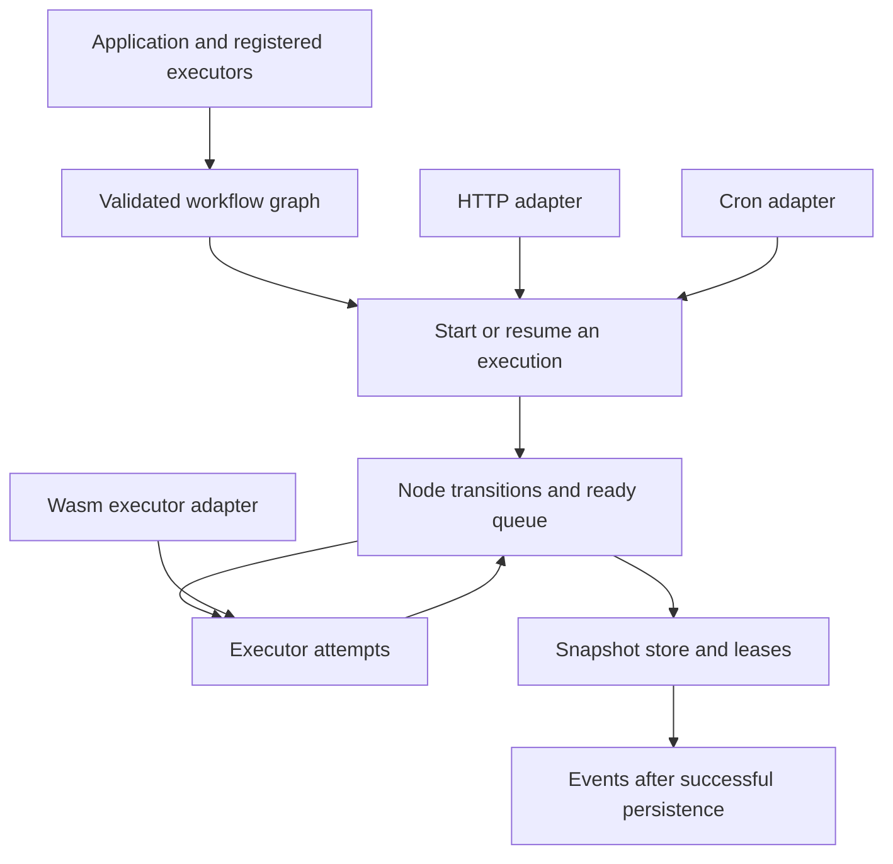

# Run dependent work with Keel

Keel is a Rust library for running a graph of tasks. A graph might fetch two
sources, combine their results, then wait for a person's approval before saving.
A directed acyclic graph (DAG) expresses which tasks must finish before another
can start; the graph cannot contain a dependency cycle.

The application supplies the actual work through executors. Keel decides when
nodes may run, limits concurrent work within one execution, remembers outcomes,
and can recover an execution from a saved snapshot. It does not understand
agents, typed business data, HTTP or SQL inside its kernel. Optional sibling
crates add SQLite storage, an HTTP API, cron starts and WebAssembly execution.

## Choose a task

- [Define dependencies and joins](graph.md), then [start a run](startup.md).
- [Pause for approval and complete a wait](waiting.md).
- [Choose retry and failure behavior](failure-policy.md), or [cancel work](cancellation.md).
- [Recover after process death](recovery.md) and [understand saved evidence](persistence.md).
- [Call from another process](http.md), [start on a schedule](schedule.md), or
  [run a trusted Wasm component](wasm.md).
- [Find a feature owner](inventory.md) and [inspect current verification](verification.md).

## Four facts to keep separate

A handle returned by ordinary `start` is not a durable-start acknowledgement.
A node Waiting for a token is not a finished execution. A terminal execution can
be Completed with mixed node outcomes rather than all Succeeded. A saved snapshot
supports at-least-once recovery, not exactly-once external effects.

The checked source revision is recorded per page. Examples and stress fixtures
are supporting material, not another product UI. No HTTP route or schedule is
implicitly part of the kernel just because its sibling crate is in the workspace.
