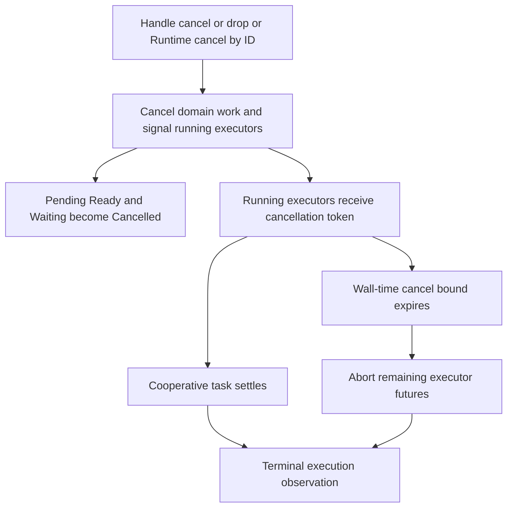

# Cancel an execution deliberately

Suppose a user closes a workflow while an executor waits on a remote API. Calling
`handle.cancel().await` requests cancellation; keeping the handle and awaiting
`wait()` lets the caller observe terminal execution state. Dropping an unused
ExecutionHandle also requests cancellation. It does not detach work for later
observation.

## What cancellation can and cannot undo

The default bound for uncooperative running tasks is 50 ms, configurable on the
Runtime. This sleeper uses Tokio wall time, not the injected Clock. The drive
aborts it when leaving, and the spawn owner aborts leftover executor tasks.
Already-issued remote requests or host I/O may still have effects. A Cancelled
snapshot is not a transactional rollback of those external systems.

Cancelling an already terminal execution is a no-op: it does not rewrite Succeeded,
Failed or Completed to Cancelled. Old completion events cannot revive cancelled
work. Store-backed cancellation by ID must claim the execution and persist its
transition; a persistence error is not returned as success. Handle cancellation
itself has no durable receipt result, so distinguish the two entry points.

## Handle wait and Runtime lifetime

Once polled, `wait()` marks its consumed handle before waiting for terminal
state. Cancelling that polled wait future therefore differs from dropping an
unused handle: Drop still requests drive shutdown, but does not send the ordinary
Cancel transition through that consumed-handle path. Do not infer a durable
Cancelled snapshot from it. An unpolled wait future has not set that consumed flag. Use the explicit
cancel API while retaining access when cancellation is intended. Dropping Runtime
releases its store leases; that is not an instruction to erase snapshots.
A replacement owner must still follow [recovery](recovery.md).

If the scheduler disappears without publishing terminal state, `wait()` returns
synthetic Cancelled when its watch channel closes. That observation means the
local drive stopped; it does not prove a Cancelled snapshot was persisted or
remote effects were undone. Inspect store evidence before making a recovery decision.

The [HTTP](http.md) server retains live handles so request-handler return does not
cancel a run. The [cron](schedule.md) adapter consumes each handle in a waiter,
so stopping future schedule ticks does not cancel already started executions.
These ownership differences are source-reviewed. The wait-token and retry models
check narrow no-new-work-after-cancel guards, not executor abort timing or remote
rollback.
