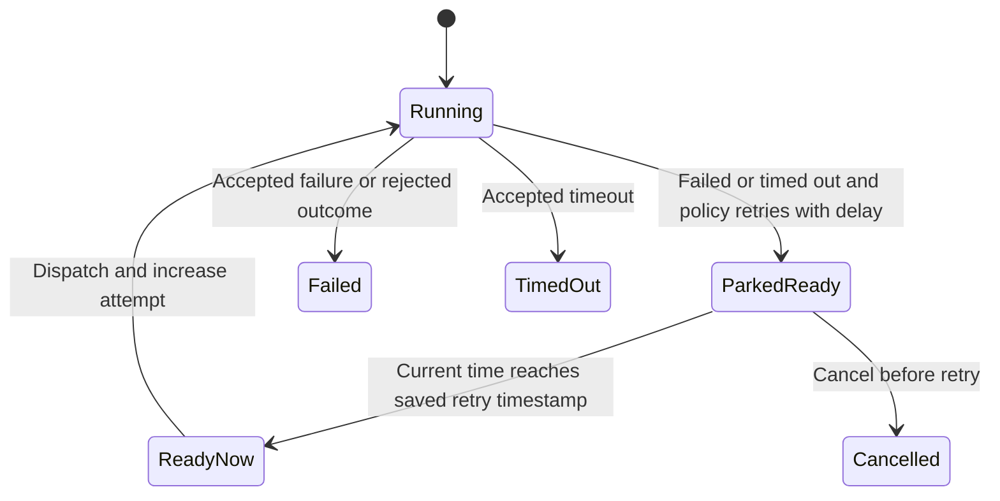

# Retry a failed attempt without confusing it with a gate

If an HTTP fetch fails temporarily, a RetryPolicy can schedule another attempt
after a delay. That node is Ready with a future runnable timestamp. It is not a
Waiting gate and does not need an approval token. A timeout returned by an
executor is an outcome for policy, not the same as the retry's wake-up time.

## Time and policy

A zero-delay retry is immediately Ready. A delayed retry saves `runnable_at` in
the snapshot; the runtime waits through its Clock, then RetryDue clears the timestamp
before dispatch. Cancellation stops that path. An executor's own timeout remains
Running until its outcome arrives; after a crash that attempt is re-invoked and
its internal timeout is rearmed, rather than restored as a retry timestamp.

RetryPolicy limits attempts. Retrying after Succeeded or Waiting is an illegal
policy decision and fails the execution; a policy panic also fails closed.
Policy Reject fails the node. Successful predecessor bytes are preserved for
ordinary retries; external effects must tolerate repeated execution.

## What fails with the node?

Default FailExecution cancels every remaining nonterminal node and ends the
execution Failed. Opt into FailSubtree on the workflow definition to cancel only
AllSucceeded descendants; siblings can continue, and AllDone reducers can run once
all their inputs are terminal. Completed then means mixed terminal outcomes, not
all Succeeded. `is_successful_finish()` accepts Succeeded and Completed; inspect
individual node outcomes if business success requires every step to succeed.

## Model boundary

`RetryDeadline` checks a single parked retry with a deadline of two abstract ticks.
It can become dispatchable only once due and cannot run after cancellation.
Controls remove the due-time and cancellation guards. It does not prove real-clock
accuracy, fairness, attempt overflow or arbitrary policy implementations. Graph
join policy is checked separately on [dependencies](graph.md).
