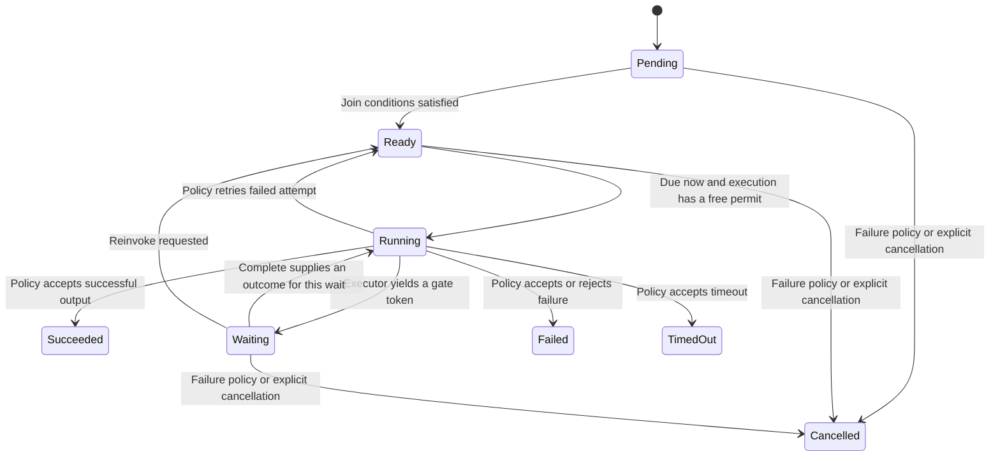

# Define a graph and follow its work

For example, fetch A and B in parallel, then combine both outputs. The combine
node remains Pending until both predecessors succeed. Finishing A alone cannot
start it. The [research diamond example](../../examples/research_diamond.rs)
shows a complete public-API workflow.

Build a `WorkflowDefinition`, register each executor before building the Runtime,
and call `run` or `start`. The definition rejects empty graphs/IDs, duplicate node
IDs, unknown edge endpoints and cycles. Missing executor registrations are rejected
at start before any node runs. The builtin `wait` executor is already registered.

## Joins and input data

The default `AllSucceeded` join needs every predecessor to succeed. `AllDone` is
an explicit per-node alternative: every predecessor must be terminal, including
Failed, TimedOut or Cancelled. Configure it on the definition, not the Runtime.
Inputs contain only successful predecessors' opaque byte outputs keyed by NodeId;
AllDone does not manufacture bytes for failed inputs. The application interprets
them and supplies any data validation.

## Running and waiting use different capacity

A FIFO ready queue dispatches while per-execution permits are available. Running
attempts hold permits; a node yielding Waiting releases its permit. Many waiting
gates can therefore coexist without exhausting execution capacity. The configured
concurrency is not a limit across every Runtime execution or cron fire. The apply
inbox is unbounded; application admission still matters under sustained producers.

Snapshot iteration follows definition order. A raw lookup is by NodeId, not an
internal graph index. `running_count` and `waiting_count` distinguish work using
permits from gates awaiting external input.

## Model boundary

`DependencyJoin` models two predecessor outcomes, one dependent and a selected
join policy. It checks the dependent cannot start before the corresponding join
condition and cannot exceed a one-permit capacity with an independent running
peer. Controls weaken join readiness and permit admission. It does not model
arbitrary graphs, FIFO fairness, queue deduplication or every cancellation route.
The chart is a node overview; retry timing, completion authority and cancellation
have their own pages.
