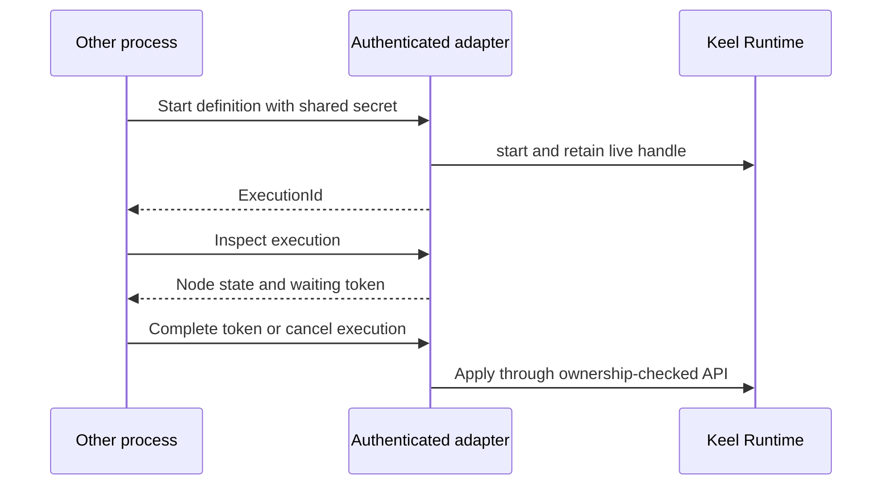

# Control a workflow from another process

An application can expose the HTTP sibling crate so another process starts work,
reads a waiting token and submits a decision. Register executors in the server's
Runtime first. Clients send graph definitions, not executable code or a request
to install a new executor. The [SDK loop example](../../crates/keel-rt-http/examples/sdk_loop.rs)
shows the KeelClient round trip.

## Routes and boundaries

| Request | Meaning |
| --- | --- |
| POST /start | Validate definition and use ordinary Runtime start, not durable startup |
| GET /executors | Registered executor IDs including builtin wait |
| GET /inspect/:id | Current visible execution/node projection |
| POST /complete | Token plus Complete/Reinvoke |
| POST /approve or /reject | Thin aliases for completion decisions |
| POST /cancel/:id | Cancel by ID; request body must be empty |

Every route requires the nonempty shared secret, using `x-keel-complete` or
Authorization Bearer. Authentication middleware runs before body parsing. Default
bind is loopback on an ephemeral port; this is not a user-account or permission
management system. Applications own deployment and access distribution.

Requests and inspect responses are bounded at 1 MiB. Successful output bytes use
base64 on this wire, not the kernel's in-process byte-array serialization. Oversize
inspect is 413, not a truncated successful view. Missing executor start errors name
the missing IDs; completion/cancel under another owner returns 423 Locked rather
than pretending malformed input. A connection timeout does not establish whether
a submitted remote effect ran; inspect the execution and respect token semantics.

## Handle ownership

The server retains nonterminal handles, including Waiting, so an HTTP handler
return does not cancel the execution. Terminal handles are reaped. Request return
is not terminal work completion. Server teardown can drop retained handles and
request cancellation; it is not an automatic detach service. The HTTP layer has
no remote executor-registration endpoint, YAML interpreter or kernel UI.

This adapter shares [startup](startup.md), [waiting](waiting.md) and
[cancellation](cancellation.md) behavior; its authentication/body limits and wire
mappings are source-reviewed and exercised by sibling tests, not a separate TLA
proof of a network server.
