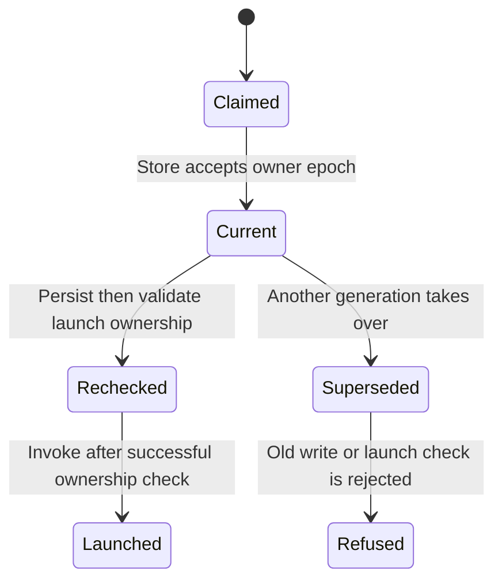

# Refuse work from an owner that lost its claim

Two processes can try to recover the same execution. The store lease chooses
which one may write and launch new work; it does not make old external effects
vanish. For example, an old network request may already be in flight when a newer
runtime takes over. Application idempotency is still needed.

## A successful check is a point-in-time observation

The scheduler awaits a heartbeat, then invokes application code in a separate
step. A long pause or lease expiry/takeover between that check and invocation is
not an atomic store-and-launch transaction. This atlas does not promise that no
old invocation can begin after such a takeover. Nor can it retract external work
already issued. Use application idempotency or external-resource fencing when
that stronger guarantee matters.

## Which checks matter

The scheduler stamps its current epoch onto the live execution for persistence.
After persistence returns, it refreshes the lease before launching executor work.
If a heartbeat fails and re-claim produces a different epoch, it releases that
new claim and stops rather than treating it as permission to continue old work.
Completion and cancellation injection also claim-or-forget their live inbox.
Forgetting an old inbox compares channel identity so it cannot unregister a new
drive under the same execution ID.

The adapter's ownership contract and real clock determine takeover eligibility.
An observed ClaimedElsewhere is a refusal to inject locally; route operations to
the live owner or wait for a legitimate ownership change. Do not force another
`start` and assume it addresses the same execution.

## Model boundary

`LeaseFence` represents two epochs and old/new presented tokens that have been
issued by that generation. It checks store write acceptance and the launch
ownership-check decision use the current epoch at that atomic check. It does not
model actual invocation after the check, or prove the check-to-invocation gap is
safe. Controls remove each epoch comparison. Takeover eligibility is an abstract
environment event; TTL, owner authorization, heartbeat scheduling and SQLite
transactions are not proved. Already issued work remains outside these checks. [Persistence](persistence.md) explains durable evidence.
