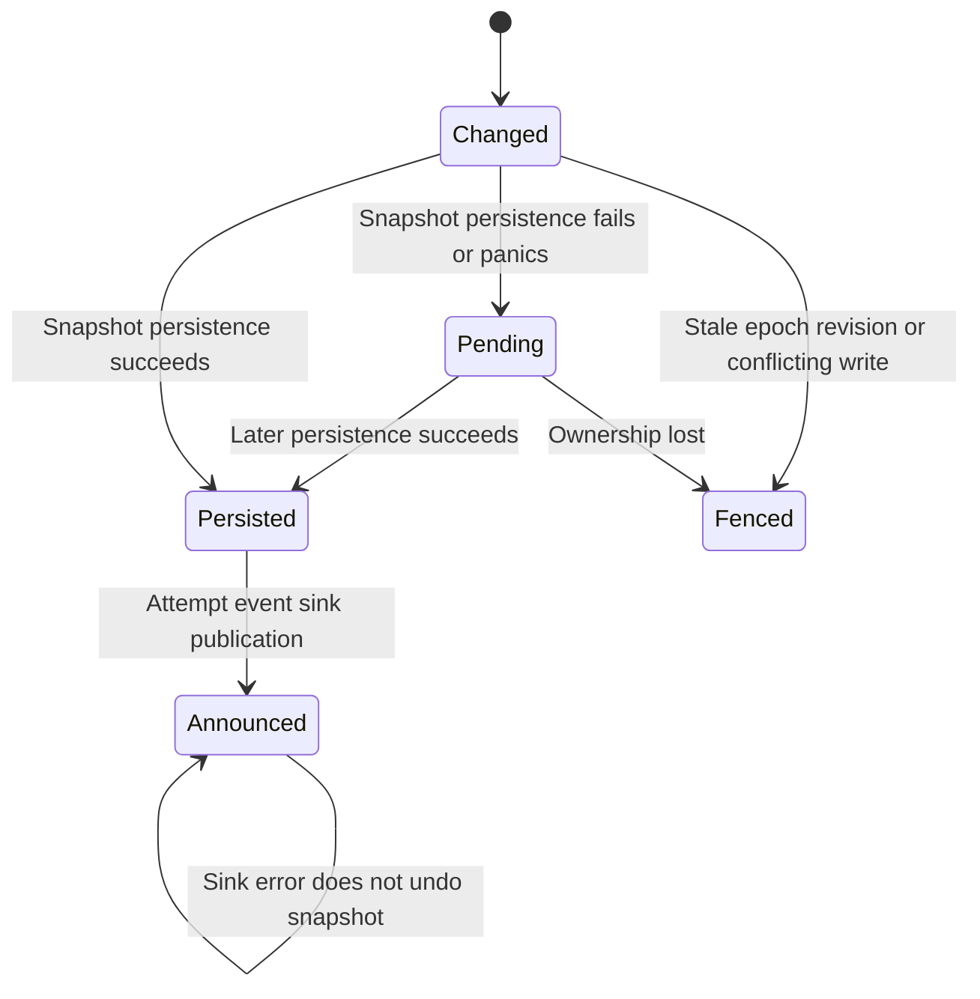

# Know what survived and who may write

The live execution can advance even when a store write fails. Keel does not roll
back its in-memory transition. It retries persistence on later activity and on
shutdown; events waiting for the sink are retained until persistence succeeds.
A sink error occurs after the saved state and does not undo it.

## Persistence errors are not an undo operation

For a real store, sink events are emitted only after successful persistence;
NoopStore intentionally skips snapshot construction and emits without durability.
An ordinary non-fencing store failure can still leave an executor launch possible
once ownership is checked. Do not read the ordering chart as “every store error
prevents all effects.” Stale epoch/revision/conflict errors instead stop that owner
from dispatching more work. Shutdown has a bounded set of extra persistence
attempts, not an infinite guarantee that an unavailable disk eventually recovers.

MemoryStore keeps snapshots in process. SQLite stores definition, execution and
dirty node rows transactionally; optional event rows share that transaction and
are never the recovery source. Equal revisions do not duplicate those event rows.
No-op domain events do not advance the revision merely to manufacture a write.

## Lease generations fence stale owners

A lease is a temporary store claim for one execution. A Runtime has its own owner
identity; a claim returns a generation called an epoch. Another unexpired owner
is refused. Dispatch refreshes ownership after persistence and before invoking
application code, because a successful write can return after another owner took
over. Stale epochs are refused by the store write and launch-ownership checks. The
check and actual invocation are separate steps; [lease timing limits](leases.md#a-successful-check-is-a-point-in-time-observation)
explain the possible pause/takeover gap.

SQLite retains its generation across release and later claims. Heartbeats and
writes must use the current active epoch. Releasing an old epoch is a no-op, so
an old caller cannot release a replacement's lease. Default StateStore methods
are permissive hooks for test/noop implementations; a custom durable adapter must
implement the documented claim/fencing contract, not inherit a false safety claim.

## SQLite durability choices

`SqliteStore::open` defaults to WAL with synchronous FULL. `open_fast` uses NORMAL:
it supports process-crash recovery but may lose the last WAL frames on power loss.
Terminal snapshots trigger a best-effort checkpoint after commit; checkpoint
failure does not undo a committed transaction. See the
[adapter guide](../../crates/keel-rt-sqlite/README.md) for the precise contract.

## Model boundary

`PersistEmit` checks one changed revision: sink publication requires persistence,
and a sink failure leaves the saved fact intact. `LeaseFence` is owned by the
[lease detail page](leases.md), separating owner generations from this ordering
model. Controls allow an early sink event and rollback after sink failure.
The abstractions exclude SQLite internals, power loss, unbounded retries and
external-effect idempotency. Application state can remain ahead of disk on failure.
