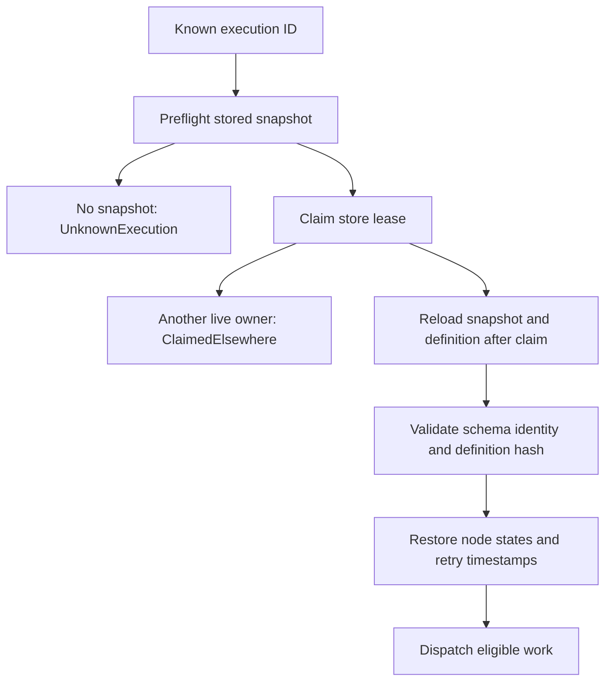

# Continue after process death

After a worker crashes, use the original ExecutionId with `Runtime::resume` on
its store. Calling `start` instead creates another execution. The store needs both
the snapshot and the original workflow definition, and the new Runtime must
register all required executors before any work can continue.

## Which nodes run again?

| Saved node | Default Continue recovery |
| --- | --- |
| Running | Becomes Ready-now and is invoked again with a new attempt |
| Ready with a retry timestamp | Keeps its timestamp and waits until due |
| Waiting | Keeps the same waiting token |
| Succeeded, Failed, TimedOut, Cancelled | Retains that terminal outcome |

A Running attempt may have performed its external effect before the crash. Resume
is therefore at least once; executors need stable business IDs/idempotency when
duplicate effects matter. Events are not replayed to reconstruct execution.
Schema mismatch, changed definition hash, missing nodes or unknown nodes refuse
restoration rather than silently guessing another graph.

## Explicit RetryFailed is different

`resume_with(id, Recover::RetryFailed)` applies only to Failed or Completed
executions. Failed/TimedOut nodes and cancelled dependents are reset for recovery,
with fresh attempt fields while retained errors remain available. A succeeded
AllDone join whose direct inputs include a retried failed node is also reset and
its output cleared. Thus “Succeeded never reruns” describes default Continue,
not an unconditional promise across RetryFailed. The recovered snapshot is
persisted before dispatch. Waiting nodes remain waiting.

## Missing state and failed completion

An ordinary start interrupted before its first snapshot may leave only a lease
reservation. Reading it returns no execution, but neither releases ownership nor
proves an executor never ran. Retain original submission inputs and business IDs;
there is no automatic safe replacement-start deduction from UnknownExecution.
For a live or offline completion/cancel error, inspect the current snapshot and
ownership before retrying. In-memory state can have advanced while persistence
failed, and an offline completion may have persisted before its follow-up drive
could start. [Durable startup](startup.md) closes the initial acceptance gap but
does not make every future external effect exactly once.

This recovery table is source-reviewed and covered by Rust resume tests. The
startup and lease models check selected prerequisites; they do not prove arbitrary
snapshot deserialization or the full RetryFailed graph transformation.
