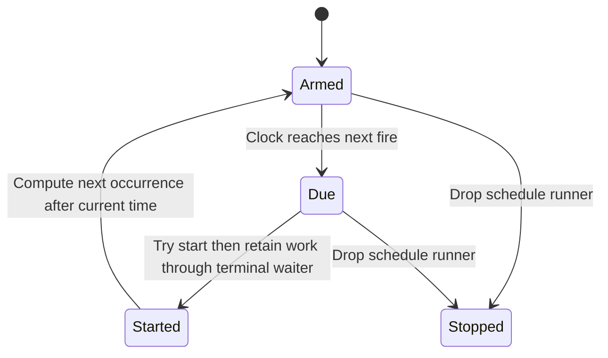

# Run a definition on a schedule

For an hourly export, create a ScheduleSpec with a five-field cron expression,
an IANA timezone and a reusable definition. Run the Schedule and keep its returned
RunningSchedule handle. Each fire creates a fresh ExecutionId through ordinary
Runtime::start, so this does not give durable-start acknowledgement or globally
limit overlapping exports.

## Missed fires, overlap and stopping

A time jump catches up once per due schedule, then computes the next occurrence
from now; it does not replay every missed interval. Existing live runs do not
suppress the next fire. The default maximum of 64 start attempts per wake bounds
a burst, not total live executions. Remaining due jobs stay queued for the next
loop and the driver yields to running work.

Dropping the schedule runner aborts future ticking only. Each successfully started
execution has its handle consumed by a detached terminal waiter, so it is not
cancelled when the ticker is dropped. Keep separate execution control if the
application must stop already started jobs. A process crash loses the ticker;
the caller reconstructs schedule specs. No durable cron registry is provided.

## Calendar interpretation

Specs reject non-five-field cron and unknown timezones. The next fire is strictly
after the supplied time. Daylight-saving behavior comes from the cron/timezone
library and its tests; do not invent two fires or a nonexistent local minute.
When no future occurrence exists, that spec is retired without stopping siblings.
A clock that never reaches its armed timestamp can wait forever until the runner
is dropped. There is no scheduler liveness proof in this atlas.

This is a sibling calendar-start loop, not the kernel's Ready retry timestamp.
[Retry policy](failure-policy.md) governs waiting between attempts in one execution.
The flow is source-reviewed and its calendar/burst/drop behavior belongs to the
schedule crate's actual tests, not the finite retry model.
