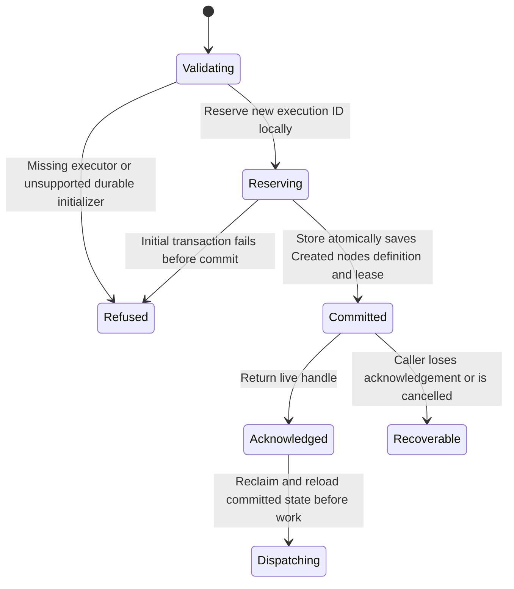

# Decide what a successful start must promise

An application submitting a payment workflow may need to know that the execution
can be found after a process crash. Ordinary `Runtime::start` returns a live
handle without promising that initial state reached durable storage. Use
`start_durable(definition).await` when that initial recovery promise is required,
with a store that explicitly supports durable initialization.

## Durable acceptance and uncertain acknowledgement

SQLite file-backed initialization writes the new lease, Created snapshot, all
nodes and workflow definition in one transaction. MemoryStore and NoopStore do
not provide this initializer; temporary/in-memory SQLite databases cannot
acknowledge durable initialization. Existing IDs must never be overwritten.
No executor dispatch occurs before the initializer succeeds.

Cancellation or a lost reply after commit can leave recoverable state even when
the caller did not receive a handle. Retrying startup always creates a new
ExecutionId, not an idempotent submission. Keep stable business operation IDs and
original submission inputs outside Keel when duplicate effects matter. If the
original execution ID is known, inspect/recover it rather than assuming another
start is the same operation. If it is unknown, Keel supplies no automatic
business-request lookup/deduplication procedure.

A delayed starter reclaims and reloads committed state before dispatch. Another
owner may already have advanced or cancelled that snapshot. A durable
acknowledgement is only the initial acceptance boundary: later storage errors
and external side effects still follow the normal rules in [persistence](persistence.md).

## Keep or consume the handle

`start`/`start_durable` return a handle whose drop requests cancellation. Keep it
while inspecting, waiting at a gate or completing tokens. `Runtime::run` is the
simple start-plus-terminal-wait path. `wait()` consumes a handle; `wait_stable()`
returns at Waiting or terminal while retaining it. See [cancellation](cancellation.md)
for cancellation of these operations rather than assuming all dropped futures
have identical behavior.

## Model boundary

`DurableStart` checks one new execution: acknowledgement and dispatch require a
committed initial snapshot. It independently represents commit, acknowledgement,
launch and a caller lost before acknowledgement. Controls bypass each commit
guard. Ownership generations are checked by the separate [lease model](leases.md). Filesystem durability, lost-ID discovery, adapter
atomicity and later persistence failures remain outside this model.
