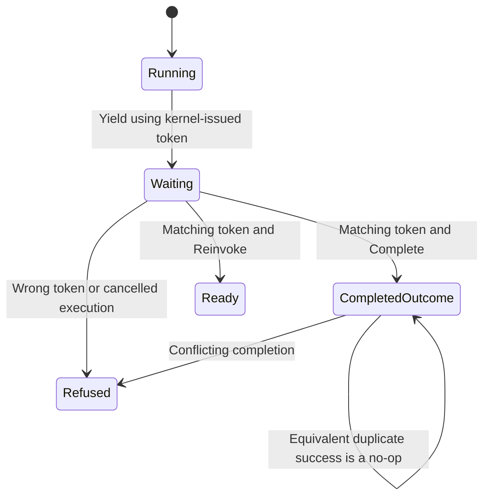

# Wait for a person's decision

A workflow can finish a draft and pause before publishing it. Add a node using
the builtin `wait` executor, or have an executor yield Waiting. Keep the execution
handle, call `wait_stable().await`, inspect the waiting node's token, then pass it
to `Runtime::complete(token, Resume::Complete(outcome)).await`. The
[waiting example](../../examples/waiting.rs) shows the in-process handle route.

## The token identifies an attempt

The kernel issues the token when dispatching and binds it to execution, node and
attempt. An executor's arbitrary supplied token cannot replace the kernel token.
While Waiting, equality with the retained token is required. `Complete` feeds an
outcome through policy; `Reinvoke` schedules the executor again without treating
it as a fresh retry attempt. Neither operation should be replaced with `start`,
which creates a new execution.

An equivalent completion after success is an acknowledged no-op; a conflicting
outcome is refused. This duplicate-success path is distinct from accepting a new
Waiting transition and is not modeled as a fresh token authorization decision.
Cancelled/failed terminal paths are not revived by completing an old token.

## Which owner receives the reply?

If this Runtime owns the live drive, completion checks its store lease and injects
into that drive. Otherwise it preflights existence, claims ownership, reloads the
snapshot and definition, applies and persists the result before driving successors.
A competing live owner produces ClaimedElsewhere. A store error can occur after
in-memory state changed; inspect before inferring nothing happened. An offline
completion can persist successfully even if starting its follow-up drive fails;
receipt success should not be read as proof all successors already ran.

Waiting is not terminal, so `wait()` can remain pending indefinitely until the
application supplies input or cancellation. The HTTP adapter offers a separate
[authenticated out-of-process route](http.md); the kernel has no human form UI.

## Model boundary

`WaitToken` models one Waiting decision, independently chosen current/offered
attempt tokens, and cancellation before acceptance. It checks new acceptance
uses the current token and a noncancelled execution. Controls remove each guard.
It excludes duplicate-success handling, unforgeability, policy interpretation,
store ownership and multiple nodes. Those remain source and implementation tests.
