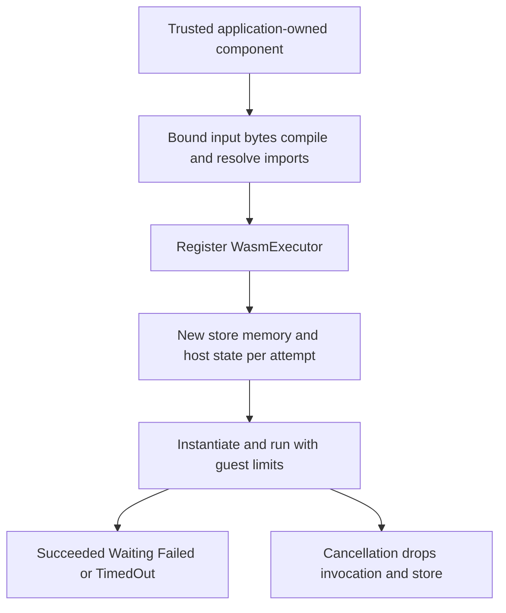

# Add a component as an executor

An application can register a WebAssembly Component for a transformation step.
The application chooses its WIT interface, imports, exports and mapping to Keel
outcomes; the adapter supplies fresh invocation state, guest resource limits and
cancellation. A core Wasm module alone is not a Component Model binary.

The [complete echo example](../../crates/keel-rt-wasm/examples/echo.rs) passes native
predecessor bytes through a component and checks the result. It uses a repository
WAT component, so no guest compiler is required. Read the
[adapter guide](../../crates/keel-rt-wasm/README.md) before providing custom bindings.

## Construction is a separate trust boundary

Only trusted pre-vetted components belong in `new_trusted`/`from_trusted_file`.
Input is capped at 1 MiB and file input must be a regular bounded file, but
compilation happens synchronously outside invocation fuel/time/memory limits.
Do not treat that byte cap as a sandbox for arbitrary uploads. Less-trusted
compilation needs a separately bounded process; timing out a compiler thread's
future does not stop its allocations. No native compiled artifact deserialization
or default WASI/network/filesystem imports are supplied.

## Invocation and recovery

Every attempt gets fresh guest memory and host state, including retries and
snapshot resume. Guest memory is not in Keel snapshots. Persist cross-attempt
state explicitly in workflow data or external storage, and make external effects
idempotent where required. Initialization/start functions share invocation limits.
Default budgets are 10 million fuel, a 10,000-fuel cooperative yield interval,
64 MiB per memory with one memory, one table of 10,000 elements, 16 core instances
and a 30-second timeout using the ExecutionContext Clock.

Timeout returns TimedOut. Fuel exhaustion, traps, binding errors and resource
limit violations become Failed. Cancellation drops the future/store without a
background invocation worker; directly calling Executor::execute reports failure,
while Keel owns its Cancelled state. Host I/O already issued can still have effects.
Trusted Rust hooks must not block the executor thread; guest limits do not bound
host allocations, synchronous hooks or compilation.

This page describes implemented adapter contracts and exclusions. No TLA model
of Wasmtime or host capabilities is claimed; the adapter and consumer tests are
listed separately in [verification](verification.md).
